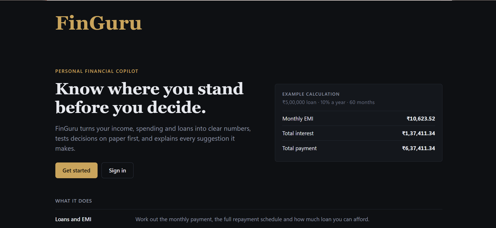
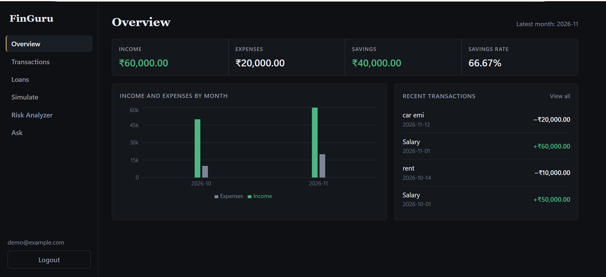
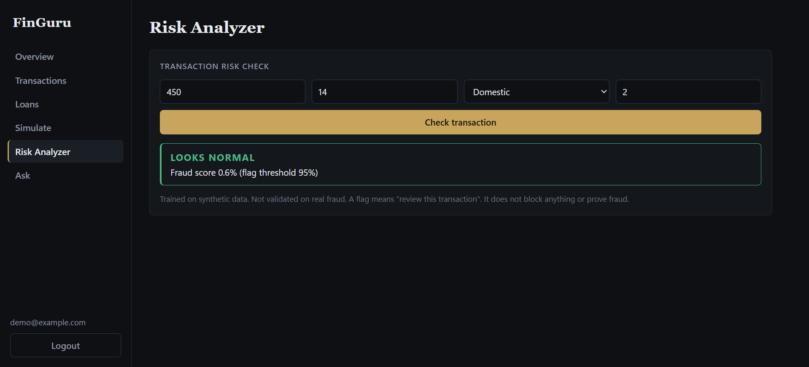
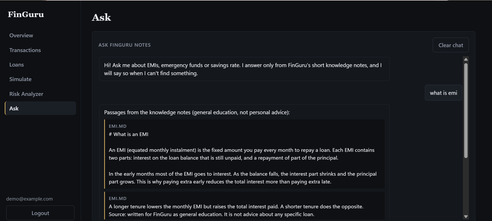

# FinGuru

\

A personal finance app I am building step by step to learn backend, frontend, applied ML, retrieval and agent workflows.
It uses synthetic data only. Nothing here is financial advice.

## Live demo

- App: https://finguru-17l0.onrender.com
- API docs: https://finguru-api.onrender.com/docs

It runs on Render's free plan, so:

- the first request after a quiet period can take about a minute while the server wakes up
- data lives in a temporary SQLite file and is erased whenever the server restarts or redeploys
- signups are capped (`MAX_USERS`), so use a made-up email and made-up data only

## What it does

- **Accounts:** landing page, create account, sign in (Argon2 password hashing, JWT)
- **Transactions:** add, edit and delete income and expenses, private to each user
- **Overview:** latest-month income, expenses, savings and savings rate, a compact monthly chart, recent transactions
- **Loans:** EMI calculator, repayment schedule, affordability, and a "what if I take this loan" scenario
- **Digital Twin:** what-if scenarios (income change, new loan) with before/after comparison
- **Next Best Action:** readable rules (HELP, WARN, SAVE, NO ACTION), each result includes the reason and the numbers behind it
- **Health check:** a workflow that summarizes the latest month, the savings trend and the next action. Built twice: as a plain function and as a LangGraph graph; a test checks both give identical results
- **Risk Analyzer:** a model trained on synthetic data scores a transaction and lists the main factors. It flags for review and never blocks anything
- **Ask (retrieval chat):** answers only from three short notes written for this project, shows the source passages, and says "not found" instead of guessing. There is no LLM in this app
- **MCP server:** three read-only tools (EMI calculator, next action, loan comparison) that wrap the same tested functions

### Screenshots









*Screenshots use a demo account with made-up data.*

## Architecture

```
React (Vite) --HTTP+JWT--> FastAPI --> service functions (finance.py, fraud.py, rag.py, workflow.py)
                                   --> SQLite (users, transactions)
MCP server (stdio) -----------------> the same service functions (no database access)
```

Diagrams: [docs/architecture.md](docs/architecture.md)

Rules I followed: all arithmetic lives in plain, tested Python functions; the API and MCP tools only validate inputs and call them.

## Deployment (Render, free plan)

- **API:** a web service. The build command installs `backend/requirements.txt`, then generates the synthetic data and trains the Risk Analyzer model on the server, so the model file is never committed. The start command runs uvicorn from the `backend` folder.
- **Frontend:** a static site built with Vite. `VITE_API_URL` is baked in at build time, and a rewrite rule (`/*` to `/index.html`) makes page refreshes work.
- **Settings on the server:** `SECRET_KEY`, `CORS_ORIGINS`, `MAX_USERS` and `PYTHON_VERSION` are set in the Render dashboard, never in the repository.
- Every push to `main` redeploys both services, which also erases the demo data.

## Security

- Argon2 password hashing, JWT access tokens (30 minutes), per-user data isolation (every query filters by the user id from the token; edit and delete check ownership in the SQL)
- Login rate limiting: 5 failed attempts lock an email for 15 minutes
- Signup cap (`MAX_USERS`) so a public demo cannot be flooded
- Input limits on every endpoint, and again inside the service functions, so MCP and the graph are protected too
- CORS allows only the origins listed in `CORS_ORIGINS`
- Hostile-input tests: SQL injection text, oversized fields, forged and unsigned tokens, `inf`/`nan`/huge numbers. Writing them found 9 real failures (crashes and unbounded values), which were then fixed
- The MCP tools are read-only and never touch the database

## Risk Analyzer model results (synthetic data)

Data: 10,000 generated transactions, 2% fraud, fixed seed. Test set: 2,000 rows with 40 fraud cases.

| Approach | Precision | Recall | PR-AUC |
|---|---|---|---|
| Rule: amount above 3000 | 0.185 | 0.375 | 0.319 |
| Isolation Forest (never sees labels) | 0.698 | 0.75 | 0.794 |
| Logistic Regression, threshold 0.5 | 0.293 | 0.90 | 0.862 |
| Logistic Regression, threshold 0.95 (chosen on a validation set) | 0.78 | 0.80 | n/a |

How to read this:

- I generated the data, so the fraud patterns are my own assumptions. These numbers show the workflow, not real-world accuracy.
- With 40 fraud cases in the test set, one case moves recall by 2.5 points.
- The threshold was chosen on 32 validation fraud cases and was the last value in my search grid.
- Isolation Forest was told the true fraud rate (`contamination=0.02`), which would be unknown in real life.
- The tuned row comes from a separate run that trains on a smaller training set (a validation set was held out), so its 0.5-threshold precision is 0.308 and not 0.293.

## Retrieval results (3 short notes)

TF-IDF keyword search, evaluated on questions I wrote (18 tuning, 8 held-out):

| Setup | Answered correctly | Correctly returned nothing |
|---|---|---|
| Score cut-off only (tuning set) | 13/14 | 0/4 |
| Plus coverage guard 0.5 (tuning set) | 11/14 | 4/4 |
| Coverage guard 0.5 (held-out set) | 4/5 | 3/3 |

How to read this:

- Out-of-scope questions ("which mutual fund should I buy?") matched on a single shared word. The coverage guard fixes that, at the cost of 2 more missed real questions.
- The question sets are tiny and written by me, so treat these as rough signals.
- Keyword search cannot match paraphrases. Embeddings would help but were not built.
- The three notes are written for this project and do not cover regulations, tax or investments.

## Run locally (Windows PowerShell)

Backend:

```powershell
uv venv --python 3.11 .venv
.venv\Scripts\Activate.ps1
cd backend
uv pip install -r requirements-dev.txt
Copy-Item .env.example .env
```

Settings in `backend/.env`:

| Variable | Meaning |
|---|---|
| `SECRET_KEY` | Long random value used to sign tokens (required) |
| `DB_FILE` | SQLite file name (default `finguru.db`) |
| `CORS_ORIGINS` | Comma-separated list of allowed frontend addresses |
| `MAX_USERS` | Maximum number of accounts (default 200); further signups are refused |

Generate a secret key with:

```powershell
python -c "import secrets; print(secrets.token_hex(32))"
```

Create the Risk Analyzer model (from the project root):

```powershell
uv pip install -r ml\requirements.txt
python ml\generate_data.py
python ml\train_final.py
```

Start the API (from `backend`), then open http://127.0.0.1:8000/docs :

```powershell
python -m uvicorn app.main:app --reload
```

Frontend (second window). `VITE_API_URL` is optional and defaults to `http://127.0.0.1:8000`:

```powershell
cd frontend
npm install
npm run dev
```

Open http://localhost:5173

MCP server (from `backend`, normally launched by an MCP client):

```powershell
python mcp_server.py
python try_client.py
```

`requirements.txt` lists what the API needs to run. `requirements-dev.txt` adds tests, LangGraph and the MCP server.

## Run tests

```powershell
cd backend
python -m pytest -q
```

## Known limitations

- Anyone can create an account (up to `MAX_USERS`), and there is no email verification or per-IP signup limit
- Login rate limiting is in memory: it resets on restart and is per email only (no IP limit)
- The access token lives in memory, so refreshing the page logs you out; tokens cannot be revoked
- SQLite with no migrations: on Render's free plan the data is erased on every restart or redeploy
- The Risk Analyzer model is trained on synthetic data and has not been tested on real transactions
- Next Best Action thresholds (40% EMI share, 3-month emergency fund) are assumptions, not professional advice
- The Ask chat answers each question on its own (no memory of earlier messages)

## Planned, not built

- An LLM-written answer in the chat (skipped on purpose to keep the app deterministic)
- Embedding-based retrieval, loading states in the UI
- Docker, end-to-end tests