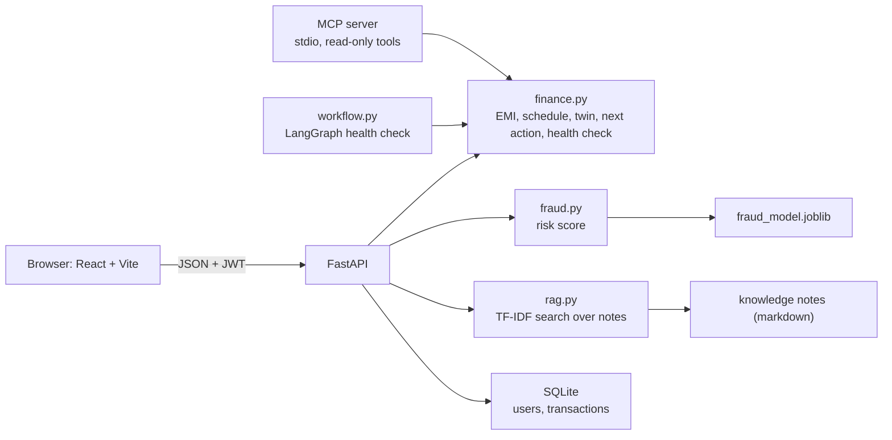
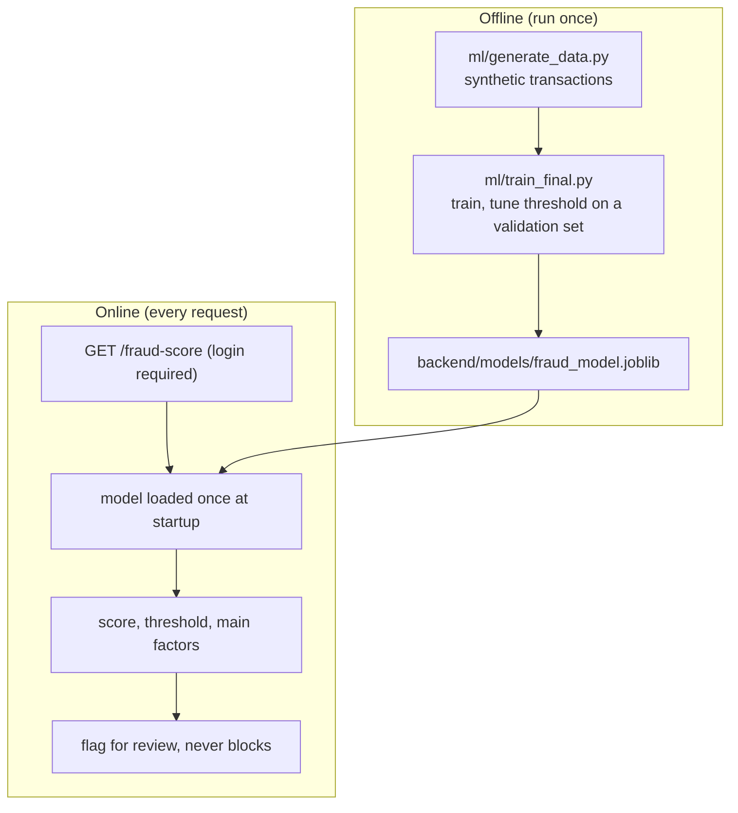
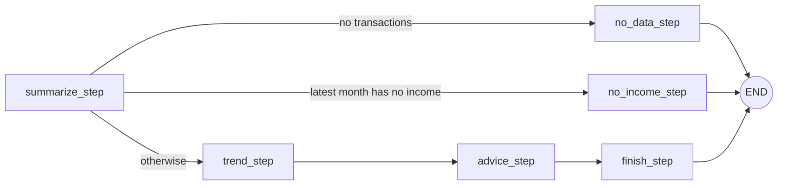

# FinGuru architecture

## 1. System overview

The API and the MCP tools only validate inputs and call the same tested functions. The MCP server never touches the database.

## 2. Risk check: training happens offline, scoring happens online

## 3. Health check workflow (LangGraph)

A test checks that this graph and the plain `health_check` function return identical results for six cases.

## 4. Design decisions

- **Arithmetic lives in plain, tested functions.** The API, the graph and the MCP tools wrap them and add no logic.
- **No LLM in the app.** Numbers and suggestions come from rules and a small model. The chat answers only from retrieved notes and says so when it finds nothing.
- **Every private query filters by the user id from the token.** Ownership is checked in the SQL itself.
- **Limits at two layers.** The API rejects out-of-range numbers, and the service functions check again, so other callers are protected too.
- **Honest scope.** The risk model is trained on synthetic data, the notes are three short files, and login limits are in memory. See the README's known limitations.